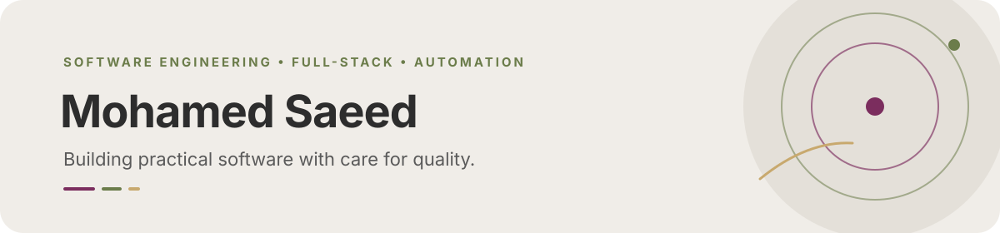

  

  <a href="#about">About</a> ·
  <a href="#engineering-focus">Engineering focus</a> ·
  <a href="#selected-work">Selected work</a> ·
  <a href="#learning-and-training">Learning</a>

## About

I’m a software developer focused on **full-stack development, Python, and test automation**. I enjoy turning requirements into clear features, connecting interfaces to APIs and data, and checking that the result works as expected.

My approach combines practical engineering with a quality mindset: keep code understandable, test important behavior, and improve the product step by step.

## Engineering focus

| Area | Tools and technologies |
|---|---|
| Web development | HTML, CSS, JavaScript, React, Angular |
| Backend and APIs | ASP.NET Core, Node.js, REST APIs |
| Testing and automation | Java, Selenium WebDriver, TestNG, API testing |
| Data and workflow | SQL Server, Git, GitHub, Postman |
| Scripting | Python |

## Selected work

- **[Complaints Management API](https://github.com/Mohammedsaeed-7/ComplaintsManagement)** — An ASP.NET Core project in progress. I’m developing the API foundation and expanding the implementation as I build out the application.
- **[Online Store Interface](https://github.com/Mohammedsaeed-7/js-project-2)** — A multi-page storefront project with product browsing, search, cart, login, and registration screens, built with HTML, CSS, and JavaScript.

[Browse all repositories →](https://github.com/Mohammedsaeed-7?tab=repositories)

## Learning and training

- Software Testing and Automation — Digital Egypt Pioneers Initiative (DEPI)
- CS50x: Introduction to Computer Science — Harvard University
- Google Cybersecurity Professional Certificate
- Responsive Web Design — freeCodeCamp

## Current direction

I’m strengthening my skills in **backend development, API design, automation, and secure software practices** through hands-on projects and structured learning.

---

  Based in Egypt · Building useful software, one project at a time.

